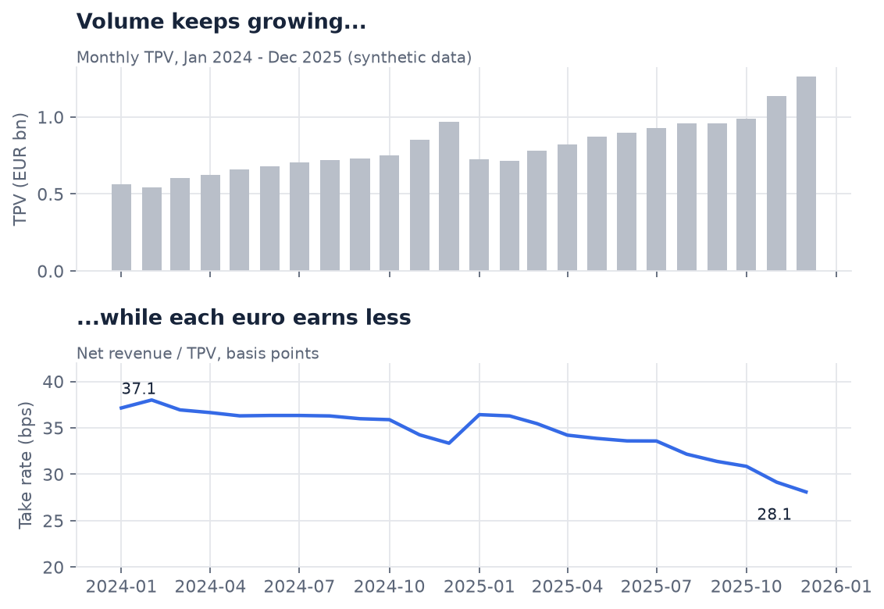
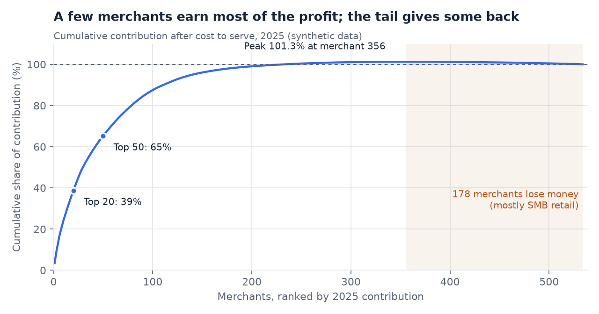
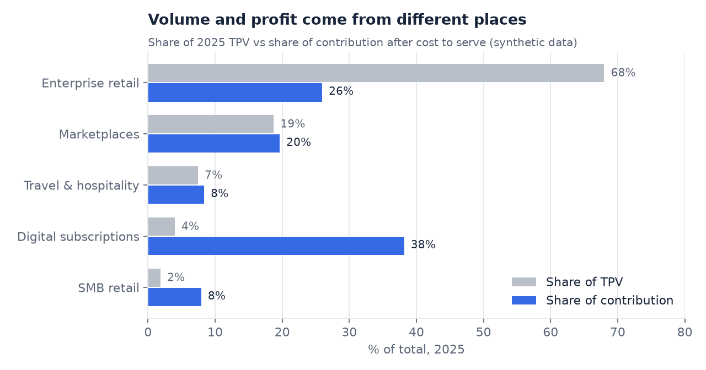
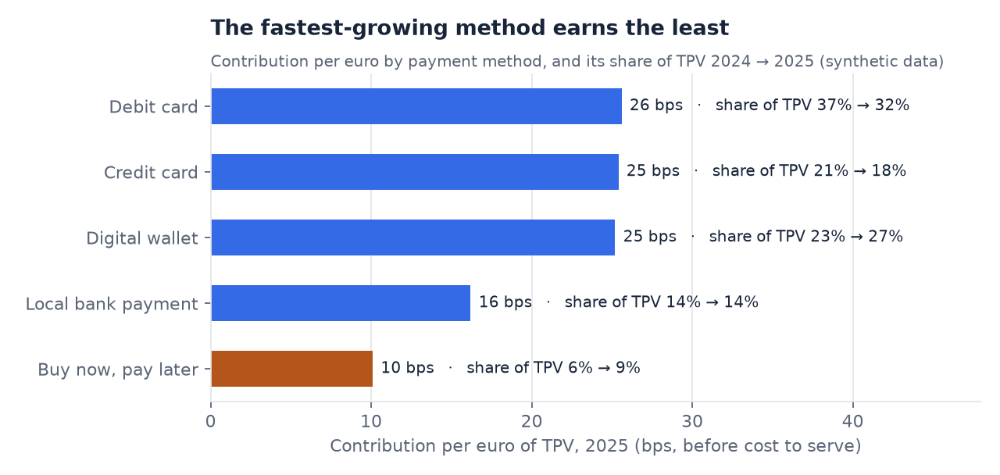
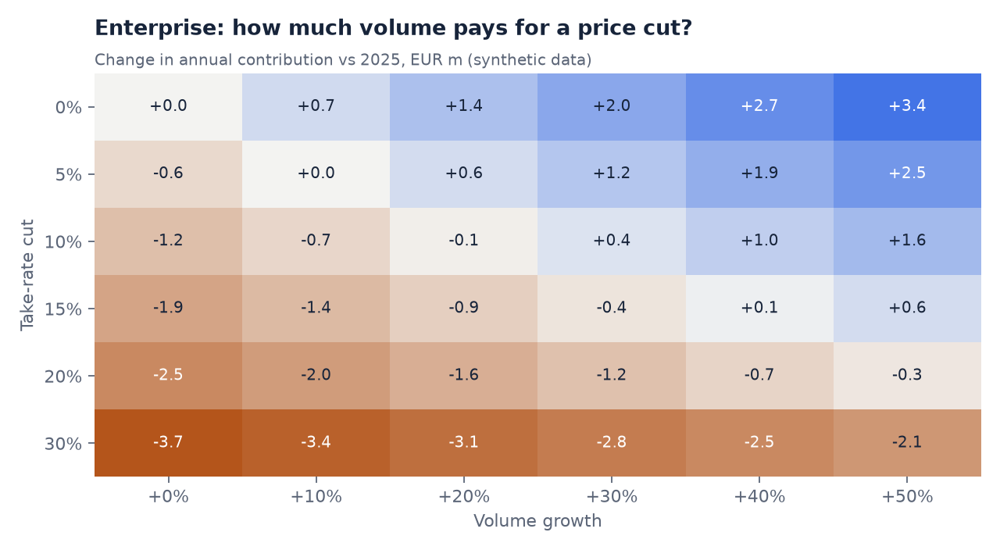

# What makes a merchant profitable?

**Independent project · Payments economics · Commercial finance**

A fictional European payments business processed €11.1bn in 2025, 32% more than in 2024. Net revenue grew only 19% and contribution 15%. This project works out why, which merchants and segments actually make the money, and what the commercial team should do about it.

> **All data here is synthetic.** It was generated by [`src/generate_data.py`](src/generate_data.py) for a made-up company. No real company, merchant or employer data is used. This is a personal project built in my own time to apply the commercial finance method I use at work to a payments business model. I have not worked in payment processing, and the cost and pricing assumptions are simplified.
>
> The patterns the analysis finds were built into the generator on purpose, so there is something to find. The method is the point, not the numbers.

**Stack:** Python (pandas, NumPy, matplotlib) · SQL (SQLite) · pytest

---

## The decisions first

| # | Recommendation | Why | Estimated effect (synthetic data) |
|---|---|---|---|
| 1 | **Tie enterprise price cuts to volume commitments, in tiers.** No flat take-rate cut at renewal. | Enterprise volume grew 27% in 2025, but renewals cut the take rate by 21%, so contribution *fell* 18%. A 10% cut needs 22% more volume just to stand still; a 20% cut needs 57%. | Each 5% of take rate given away without matching volume costs about €0.6m a year |
| 2 | **Reprice buy now, pay later (BNPL) for marketplaces** by +0.3 percentage points. | BNPL is the fastest-growing method (6% → 9% of TPV) and earns the least: 10 bps after costs, against about 25 bps for cards and wallets. | +€0.8m to +€1.1m a year, depending on how much volume moves to cards |
| 3 | **Introduce a minimum monthly fee** (€250 of net revenue) for small merchants on blended pricing. | 178 merchants lose money after the cost of serving them; 172 of them are small retail merchants. Together they lose €0.26m a year. | About +€0.2m a year, even if 40% of the affected merchants leave |
| 4 | **Point new-business effort at digital subscriptions and marketplaces.** | Digital subscriptions are 4% of volume but 38% of contribution, at a 223 bps take rate. Marketplaces grew volume 56% and contribution 43%. | Not modelled: a targeting decision, not a price change |

Recommendations 2 and 3 together add about €1.2m, roughly 6% of 2025 contribution. Recommendation 1 protects more than that. Enterprise take rate fell 21% in 2025 on 27% more volume. Had the cut been held to 10% on the same volume, enterprise contribution would have been about €1.75m higher. (The same formula, run with the actual 21% cut, reproduces actual 2025 enterprise contribution to within €0.05m, which is a useful check on the model.)

---

## The business questions

### 1. Is growth turning into profit?

Less and less. Volume grew 32%, but each euro of volume earns less over time.

| | 2024 | 2025 | Change |
|---|---:|---:|---:|
| Total payment volume (TPV) | €8.40bn | €11.05bn | +31.5% |
| Net revenue | €30.2m | €35.9m | +19.0% |
| Take rate (net revenue / TPV) | 35.9 bps | 32.5 bps | −3.4 bps |
| Contribution after cost to serve | €18.0m | €20.7m | +15.2% |
| Contribution margin (of net revenue) | 59.5% | 57.6% | −1.9 pts |

The monthly take rate fell from 37.1 bps in January 2024 to 28.1 bps in December 2025. Two things drive it: enterprise renewals at lower prices, and the payment mix moving towards BNPL.



### 2. Which merchants contribute most?

A small group. The top 20 of 534 active merchants earn 39% of contribution, and the top 50 earn 65%. After that the curve flattens, peaks at 101.3%, and the last 178 merchants give some of it back.



Volume and profit come from different places. Enterprise retail is 68% of volume but 26% of contribution. Digital subscriptions are the opposite: 4% of volume, 38% of contribution. Small merchants on blended pricing pay a much higher take rate (145 to 225 bps) than enterprise merchants on interchange++ (16 bps), so a euro of their volume earns 9 to 14 times more.



### 3. Which segments grow but get less profitable?

| Segment | TPV growth | Take rate 2024 → 2025 | Contribution growth | Why |
|---|---:|---:|---:|---|
| Enterprise retail | +27% | 20.8 → 16.4 bps | **−18%** | 15 of 20 merchants renewed at lower prices in 2025 |
| Marketplaces | +56% | 40.8 → 37.1 bps | +43% | BNPL rose from 13% to 21% of their volume (Q4 2024 vs Q4 2025) |
| Travel & hospitality | +26% | 39.0 → 37.6 bps | +26% | Fraud and chargebacks take 18% of net revenue |
| Digital subscriptions | +36% | 222 → 223 bps | +37% | Steady pricing, small tickets, low losses |
| SMB retail | +10% | 147 → 146 bps | +11% | Profitable as a segment, but 172 of 384 merchants lose money |

Enterprise is the clear case of volume growing while profit shrinks. Marketplaces are still growing profit, but the take rate is sliding as BNPL takes over more of their volume.

### 4. How do payment methods compare?

Cards and wallets earn about 25 bps after transaction costs. Local bank payments earn 16 bps, because they are priced per transaction, not per euro. BNPL earns 10 bps, because the BNPL provider's fee takes most of the price, and it is the method growing fastest.



### 5. And by geography?

| Merchant country | TPV 2025 | Take rate | Contribution margin |
|---|---:|---:|---:|
| UK | €2.53bn | 32.6 bps | 54% |
| France | €2.43bn | 29.3 bps | 60% |
| US | €1.29bn | 48.2 bps | 67% |
| Netherlands | €1.76bn | 28.5 bps | 59% |
| Germany | €2.16bn | 21.2 bps | **46%** |
| Nordics | €0.45bn | 60.8 bps | 63% |
| Spain | €0.44bn | 46.0 bps | 55% |

Germany has the lowest take rate and margin. That is a mix effect, not a country problem: 79% of its volume is enterprise retail, and it has the highest BNPL share (17% of TPV). Country is mostly a lens on segment and payment mix; the levers are in pricing and segment focus.

### 6. What do pricing changes do to profit?

Base: 2025 actuals. Each scenario moves one lever and keeps everything else at 2025 levels. Code: [`src/scenarios.py`](src/scenarios.py).

**Volume grows while take rate falls (enterprise renewal).** Net revenue moves with volume and price; transaction costs move with volume; cost to serve does not move.



| Take-rate cut | Extra volume needed to keep contribution flat |
|---:|---:|
| 5% | +10% |
| 10% | +22% |
| 15% | +37% |
| 20% | +57% |
| 30% | +119% |

The need for volume grows faster than the cut, because the cut comes off revenue while costs still rise with every extra transaction. This is why recommendation 1 ties discounts to committed volume tiers.

**BNPL +0.3 percentage points for marketplaces.** Assumption: some BNPL volume moves to cards, where it earns the marketplaces' 2025 card rate (27 bps).

| Share of BNPL volume that moves to cards | Contribution change |
|---:|---:|
| 0% | +€1.14m |
| 25% | +€0.97m |
| 50% | +€0.80m |

**Minimum monthly fee of €250 net revenue** for blended-pricing merchants. 188 merchants are below it. Merchants who leave are assumed to take their contribution with them, and their cost to serve goes away.

| Share of affected merchants who leave | Extra fees | Effect of leavers | Contribution change |
|---:|---:|---:|---:|
| 0% | +€0.21m | €0 | +€0.21m |
| 20% | +€0.17m | +€0.04m | +€0.22m |
| 40% | +€0.13m | +€0.09m | +€0.22m |

Losing them adds to contribution because, as a group, these merchants lose €0.22m a year today. The caveat: this assumes their cost to serve really goes away. If support costs are fixed in the short run, the gain from leavers is smaller and the fee does most of the work.

---

## How the economics are measured

The model sits in one SQL file, [`sql/00_economics_model.sql`](sql/00_economics_model.sql), at merchant × month × payment method level.

```
Gross revenue           what the merchant is billed
− Pass-through costs    interchange and scheme fees (card issuers, schemes), BNPL provider fees
= Net revenue           what the business keeps            → take rate = net revenue / TPV
− Transaction costs     own processing cost per transaction, fraud and chargeback losses
= Contribution 1
− Cost to serve         account management and support, per merchant per month
= Contribution 2        "merchant profitability" in this project
```

Two pricing models, as described publicly by many payment providers:

- **Interchange++** (enterprise, marketplaces, travel): the merchant pays interchange and scheme fees at cost, plus a markup and a fixed fee per transaction. Net revenue is the markup and the fixed fee.
- **Blended** (digital subscriptions, small retail): one all-in percentage plus a fixed fee. Interchange and scheme fees come out of that fee, so cross-border cards, which carry higher interchange, squeeze the margin.

Contribution is before fixed overheads (technology, central functions), which are not allocated to merchants.

## The data

| File | Rows | What it is |
|---|---:|---|
| `data/merchants.csv` | 550 | Segment, country, pricing model, start and end month, cost to serve |
| `data/pricing.csv` | 2,880 | Contract terms per merchant and payment method, with effective dates (repricing creates a new row) |
| `data/payment_method_costs.csv` | 5 | Interchange and scheme rates, BNPL provider fee, processing cost per transaction |
| `data/monthly_transactions.csv` | 55,341 | Merchant × month × payment method: transactions, TPV, cross-border TPV, fraud and chargeback losses |

24 months (Jan 2024 – Dec 2025), 5 segments, 7 merchant countries, 5 payment methods. Some merchants join or leave during the period; travel and retail are seasonal. All rates are fictional. Column definitions: [`docs/data_dictionary.md`](docs/data_dictionary.md).

## Checks

[`tests/test_reconciliation.py`](tests/test_reconciliation.py) runs six checks so a figure can be traced back to the raw data:

- every transaction row matches exactly one price (no pricing gaps or overlaps that would drop or double count volume)
- TPV in the model ties to the raw data at every level
- the waterfall adds up: gross − pass-through = net revenue, and so on down to contribution 2
- interchange++ merchants earn only their markup and fixed fee
- cost to serve is charged once per active merchant per month

## Run it

```bash
python -m venv .venv
.venv/Scripts/activate          # macOS/Linux: source .venv/bin/activate
pip install -r requirements.txt
python src/generate_data.py     # writes data/ (seeded, so the same every run)
python src/run_analysis.py      # runs sql/01-07, writes outputs/*.csv
python src/scenarios.py         # writes outputs/scenario_*.csv
python src/charts.py            # writes outputs/charts/*.png
pytest
```

## What is simplified

- One interchange rate per card type, with a single cross-border uplift. Real interchange varies by card, region and transaction type.
- No FX revenue, refunds, chargeback fees, payouts, or minimum fees in the base data.
- Cost to serve is a flat amount per merchant by segment, not an activity-based allocation.
- Scenarios change one lever at a time and use simple, stated assumptions for how merchants and shoppers react. In a real pricing decision these reactions would be the main thing to test.
